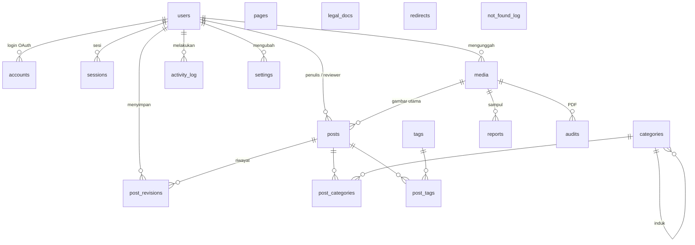

# DATABASE

Postgres (Neon via Vercel Marketplace) + Drizzle ORM. Skema: `src/server/db/schema.ts` ·
koneksi: `src/server/db/index.ts` (`getDb()`) · migrasi SQL: `src/server/db/migrations/`.

Database ini dipakai Admin CMS (prompt B1–B17). Sampai prompt B2 selesai, situs publik masih
membaca `content/*.json`.

## Menyiapkan

1. Vercel → **Storage → Create → Neon** → hubungkan ke project. Vercel menambahkan `DATABASE_URL`
   (pooled, dipakai aplikasi) dan `DATABASE_URL_UNPOOLED` (koneksi langsung, dipakai migrasi).
2. Lokal: `vercel env pull .env.local --environment=development` — **jangan** menarik environment
   production untuk development sehari-hari. Lebih aman lagi: buat branch Neon khusus dev dan pakai
   connection string branch itu.
3. `npm run db:migrate` untuk menerapkan migrasi.

| Perintah | Fungsi |
|---|---|
| `npm run db:generate` | Bandingkan `schema.ts` dengan migrasi terakhir, tulis file SQL baru (tidak menyentuh database) |
| `npm run db:migrate` | Terapkan migrasi yang belum dijalankan ke database di `DATABASE_URL_UNPOOLED` |
| `npm run db:studio` | Buka Drizzle Studio (penjelajah data) |
| `npm run db:seed` | Impor `content/` (hasil ekspor WordPress) ke database; idempoten |
| `npm run db:seed:translations` | Muat terjemahan artikel dari `content/translations/` ke `post_translations`; idempoten |

Alur perubahan skema: ubah `schema.ts` → `db:generate` → periksa SQL-nya → commit → `db:migrate`.

## Seed dari ekspor WordPress

`npm run db:seed` (`scripts/seed-from-export.ts`) meng-upsert, berurutan:

| Data | Kunci upsert | Catatan |
|---|---|---|
| Media lama (5.135) | `pathname` | Dari `content/media-manifest.json`; dimensi & alt hanya terisi untuk gambar utama post. Alt yang sudah diisi admin tidak ditimpa. |
| Kategori (37), tag (1.857) | `legacy_id` | Induk kategori dipetakan dari ID WordPress. |
| Post (670) | `legacy_id` | Status `published`, `published_at` = tanggal WordPress (WIB), SEO Rank Math, `legacy_jsonld`. Relasi kategori/tag post hasil migrasi diganti seluruhnya. |
| Halaman (51) | `path` | Template `generic`; HTML ekspor menjadi satu section `richtext`. |
| Redirect (21) | `source` | Dari `src/config/redirects.ts`; yang berpola tetap ditangani `next.config`. |
| Pengaturan (6 kunci) | `key` | `identity`, `contact`, `socials`, `menu`, `integrations`, `home`. **Tidak ditimpa** bila sudah ada. |

Post dan halaman di path aplikasi donasi (`/campaign`, `/donasi`, `/prog…`) dilewati. Menjalankan
ulang seed menimpa judul/isi/SEO post dan halaman hasil migrasi dengan isi `content/` — setelah
konten mulai disunting lewat admin, jangan jalankan lagi tanpa memeriksa dampaknya.

Catatan teknis:
- Semua file di `src/server/` diawali `import "server-only"` agar tidak pernah masuk bundle
  browser. Karena itu skrip `db:*` dijalankan dengan `NODE_OPTIONS=--conditions=react-server`;
  skrip CLI lain yang mengimpor `src/server/` (mis. seed di B2) harus memakai opsi yang sama.
- Driver: `@neondatabase/serverless` (Pool WebSocket) lewat `drizzle-orm/neon-serverless`, supaya
  transaksi interaktif tersedia.
- `getDb()` membuat koneksi saat pertama dipanggil, jadi `next build` tidak membutuhkan database.

## ERD ringkas

`pages`, `legal_docs`, `redirects`, dan `not_found_log` berdiri sendiri (tanpa foreign key).

## Enum

| Enum | Nilai | Dipakai |
|---|---|---|
| `user_role` | `super_admin`, `editor`, `penulis`, `kontributor`, `viewer` | `users.role` |
| `content_status` | `draft`, `review`, `scheduled`, `published`, `trashed` | `posts.status`, `pages.status` |
| `media_source` | `legacy` (migrasi WordPress), `blob` (unggahan baru) | `media.source` |

## Tabel

Semua tabel konten punya `created_at`/`updated_at` (timestamptz). ID memakai identity integer,
kecuali `users` (uuid, kebutuhan Auth.js) dan tabel berkunci alami (`settings.key`,
`not_found_log.path`, `sessions.session_token`).

### Pengguna & autentikasi
| Tabel | Isi | Catatan |
|---|---|---|
| `users` | Akun admin: nama, email, peran, `password_hash`, `totp_secret`, `disabled_at`, `last_active_at` | Email unik tanpa membedakan huruf besar/kecil. `email_verified` dan `image` adalah kolom standar Auth.js. |
| `accounts` | Tautan akun OAuth (Google) per pengguna | Bentuk standar adapter Auth.js; kunci utama (`provider`, `provider_account_id`). Terhapus bersama penggunanya. |
| `sessions` | Sesi login berbasis database | Terhapus bersama penggunanya; indeks pada `expires` untuk pembersihan. |

### Publikasi
| Tabel | Isi | Catatan |
|---|---|---|
| `posts` | Artikel/berita: `slug` (unik), judul, ringkasan, `content_json` (Tiptap), `content_html` (tersanitasi), status, `published_at`, penulis, reviewer, gambar utama, kolom SEO, `legacy_jsonld` | Indeks: `slug`, `status`, `published_at`, gabungan (`status`, `published_at` menurun) untuk daftar publik. `legacy_id` = ID WordPress, kunci upsert saat seed. Penulis/reviewer/gambar yang dihapus menjadi null. |
| `post_revisions` | Salinan post tiap kali disimpan (`snapshot` jsonb) | Terhapus bersama post-nya. |
| `categories` | Kategori: `slug`, `path` arsip (mis. `hewan-lingkungan/air-bersih`), nama, deskripsi, `parent_id` | `slug` dan `path` unik. |
| `tags` | Tag: `slug`, nama, deskripsi | Tidak berhierarki, jadi tanpa `path` dan `parent_id` (berbeda dari ringkasan di playbook). |
| `post_categories`, `post_tags` | Relasi many-to-many | Kunci utama gabungan; baris terhapus bila post atau istilahnya dihapus. |

### Terjemahan
| Tabel | Isi | Catatan |
|---|---|---|
| `post_translations` | Terjemahan post per bahasa: judul, ringkasan, `content_html`, SEO, `status` (`draft`/`reviewed`), `source_updated_at`, peninjau | Kunci utama (`post_id`, `locale`); terhapus bersama post-nya. Enum `translation_status`. Draf tampil di `/en/…` dengan keterangan dan `noindex`; hanya `reviewed` yang diindeks dan diberi hreflang. |

Sumber terjemahan saat ini adalah file `content/translations/en/posts/<slug>.json` (satu per artikel).
Alur tinjauan sampai editor admin tersedia: sunting file → ubah `"status"` menjadi `"reviewed"` →
`npm run db:seed:translations` → build/deploy ulang.

### Halaman & media
| Tabel | Isi | Catatan |
|---|---|---|
| `pages` | Halaman: `path` (unik, mis. `pr0gram-kami/kerelawanan`), judul, `template`, `sections` (jsonb berurutan), status, kolom SEO | Bentuk tiap section divalidasi Zod di B7. |
| `media` | Pustaka media: `url`, `source`, `pathname` (unik), mime, ukuran, dimensi, `alt`, keterangan, pengunggah | Media lama memakai pathname `wp-content/uploads/…`; unggahan baru `media/YYYY/MM/…`. |

### Transparansi
| Tabel | Isi | Catatan |
|---|---|---|
| `reports` | e-Report: judul, `year`, `themes` (array slug tema), `url` flipbook, sampul, `visible`, `sort` | Playbook menulis satu kolom `theme`; dijadikan array karena satu laporan bisa masuk dua tema, dan `year` ditambahkan karena halaman dikelompokkan per tahun. |
| `audits` | Audit keuangan per tahun (unik): opini, `pdf_media_id`, `document_url` | `document_url` ditambahkan karena dokumen saat ini masih berupa berkas Google Drive. |
| `legal_docs` | Dokumen legalitas: jenis, teks, urutan | |

### SEO, pengaturan, log
| Tabel | Isi | Catatan |
|---|---|---|
| `redirects` | Redirect: `source` (unik), `destination`, `status_code`, catatan, `hits` | `status_code` dibatasi ke 301, 302, 307, 308, 410. Disinkronkan ke Edge Config di B12. |
| `not_found_log` | URL 404: `path`, `hits`, `last_seen` | Satu baris per path. |
| `settings` | Kunci → nilai JSON (`identity`, `contact`, `socials`, `menu`, `integrations`, `home`) | |
| `activity_log` | Jejak aktivitas: pengguna, aksi, entitas, ID entitas, ringkasan, `diff` | Indeks pada waktu, entitas, pengguna, dan aksi. `user_id` menjadi null bila pengguna dihapus. |
